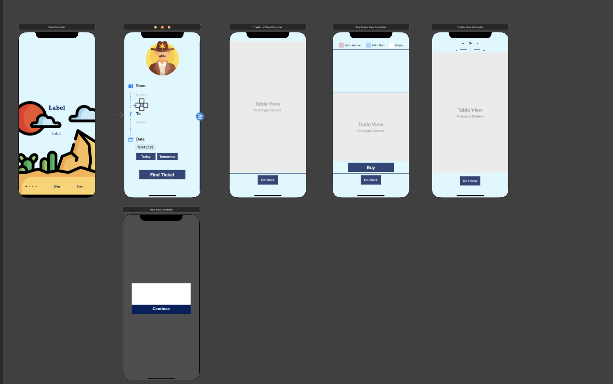

# Modern Stagecoach

A UIKit bus ticket interface exercise written in Swift. It includes city and date selection, an animated onboarding flow, travel results, seat selection, passenger entry, and a ticket summary. Seat reservations and ticket data are kept in memory by the app.

## Open and build

Use a Mac with Xcode and an iOS simulator runtime. The app specifies Swift 5 and an iOS 16.4 deployment target.

```bash
git clone https://github.com/tugcantopaloglu/modern-stagecoach-swift.git
cd modern-stagecoach-swift
open "Modern Stagecoach.xcworkspace"
```

Open the workspace because it includes both the app project and `Pods/Pods.xcodeproj`. Select the `Modern Stagecoach` scheme and a compatible simulator. For a physical device, configure your own signing team and bundle identifier.

The repository includes `Pods/`, `Podfile.lock`, and `Pods/Manifest.lock`. To restore the locked CocoaPods integration on macOS, close Xcode and run:

```bash
pod install --deployment
open "Modern Stagecoach.xcworkspace"
```

The lockfile records CocoaPods 1.12.0 and these dependency versions:

| Pod | Locked version | Use |
| --- | --- | --- |
| lottie-ios | 4.1.3 | Animated onboarding and seat screen graphics |
| ALBusSeatView | 0.2.5 | Seat layout and selection |
| iOSDropDown | 0.4.0 | City selection fields |

Third-party source and attribution are retained under `Pods/`.

A simulator build can be checked on macOS with:

```bash
xcodebuild -workspace "Modern Stagecoach.xcworkspace" \
  -scheme "Modern Stagecoach" -configuration Debug \
  -destination 'generic/platform=iOS Simulator' \
  CODE_SIGNING_ALLOWED=NO build
```

## Native build checks

The [native build workflow](.github/workflows/native-build.yml) builds the existing workspace with Xcode 16.4 on macOS 15. It verifies that the checked-in CocoaPods manifest matches the dependency lockfile, uses the app's iOS 16.4 deployment target, and saves an unsigned simulator app archive and build logs for seven days after a successful build.

Controlled simulator fixtures compile the app's existing source with a separate validation entry point and load its compiled storyboard and nib resources. They check invalid/empty/partial travel data, ticket outlets, passenger values after cell recreation, and onboarding timer bounds and cancellation. They use fabricated fixture values and make no travel API or booking-service calls. The fixtures do not replace manual acceptance of complete user journeys.

## Current limitations

- Travel results depend on the JSONBin URL in `TravelListViewController.swift`. The original project notes report that this API stopped working. Failed or invalid responses now leave the list empty, but the app has no local travel dataset or error/retry interface.
- The travel request still runs synchronously when the screen loads, so a slow response can block the interface.
- The original notes report intermittent onboarding presentation problems. The `welcome`, `secure`, and `seats` animation names also have no matching bundled animation assets.
- The app does not implement a live booking or payment service, and it has no automated app test target.
- Source and resource checks do not establish simulator or device behavior. Native builds, first-launch onboarding, travel API integration, seat selection, passenger entry, and ticket navigation require acceptance testing on macOS/Xcode.

## Screens


